# Sloan云盈客服助手 使用说明

Sloan云盈客服助手把拼多多、天猫、抖店、京东、有赞等店铺的商家客服网页放进一个桌面软件里：买家消息汇总到一处，AI 按知识库和大模型自动回复，答不了的用平台自带转接交给人工子账号，目标是每条消息 20 秒内有回应。

## 安装与启动

- **Mac**：双击 `.dmg`（Apple 芯片选 arm64，Intel 选 x64），把图标拖进「应用程序」。第一次打开时在「应用程序」里**右键点软件 → 打开 → 打开**。提示「已损坏」时，在「终端」执行 `xattr -cr "/Applications/Sloan云盈客服助手.app"`。
- **Windows**：解压 `.zip`，双击 `Sloan云盈客服助手.exe`。出现「Windows 已保护你的电脑」时点「更多信息 → 仍要运行」。
- **关闭**：Mac 按 Cmd+Q，Windows 直接关窗口。店铺、登录状态、知识库都会自动保存，下次打开不用重新登录。

想先熟悉操作，左侧自带「模拟店铺(测试)」：在「店铺后台」底部黄色栏选一个买家、输入一句话、点「买家发送」，再到「收件箱」看 AI 怎么处理。它不连任何真实平台。

## 界面导览

顶部色带的颜色表示现在谁在回复：青色 = AI 托管，蓝紫色 = 人工，橙色 = 离线接管。

| 位置 | 做什么 |
| --- | --- |
| 顶部色带 | 当前模式和原因；同步、模型状态（点模型状态可直接去设置）；右侧「自动 / AI 托管 / 人工 / 离线接管」切换；人工席位还有「我离开了」 |
| 左侧栏 | 店铺账号列表。圆点：绿 = 已连接，橙 = 未登录或未校准，灰 = 未打开。底部「添加店铺」 |
| 收件箱 | 所有店铺的买家会话汇总；每条 AI 回复下有决策过程和耗时；右侧看订单、发商品 |
| 店铺后台 | 内嵌的平台网页（登录、看原始聊天页、校准） |
| 商品库 | 常用商品和链接，一键发送、自动带链接 |
| 知识库 | QA 问答，支持 Excel 导入、导出、试答 |
| 学习 | AI 从人工回复里整理的候选问答，以及各类问题的吻合率 |
| 待办 | AI 处理不了、需要人工补上的会话 |
| 时效监控 | 每条消息从进线到回复的耗时统计 |
| 设置 | 席位、模型、双机同步、回复规则 |

任何弹窗都能用右上角 ✕、Esc 或点弹窗外面关闭。

## 三种模式

| 模式 | AI 做什么 | 答不了时 | 适合 |
| --- | --- | --- | --- |
| AI 托管 | 知识库命中直接回，没命中交给模型作答 | 发转接提示，用平台自带转接交给人工子账号 | 日常接待 |
| 人工 | 不发消息，只在后台拟草稿，和人工的实际回复对比学习 | — | 上线初期、大促、想让 AI 多学 |
| 离线接管 | 常规问题照常自动回复 | 不转接，按分类发保底话术，记入待办 | 夜间、人员离岗 |

右上角选「自动」时：

- AI 席位：同步服务里有在线的人工席位 → AI 托管；没有 → 离线接管。没开同步时一直是 AI 托管。
- 人工席位：人在 → 人工；电脑无操作超过设定分钟数（默认 5 分钟），或点了「我离开了」→ 离线接管。

## 接入店铺

1. **添加**：左下角「添加店铺」，选平台、填店铺名称。「转接给哪个人工子账号」填平台转接列表里显示的名字。
2. **登录**：「店铺后台」→「打开登录页」，扫码或输入账号密码。不想现在登录可以点「收起网页」或切到其他标签页。
3. **打开聊天页**：点「回到客服工作台」，确认看到的是买家聊天页面。点错了可以点「后退」。
4. **校准**：告诉软件页面上每样东西在哪，见下一节。
5. **确认连接**：左侧圆点变绿，店铺后台顶部显示「已连接 · 识别到 N 条消息」。

建议先用「人工」模式观察一天，确认消息识别准确，再切到 AI 托管。

## 校准（详细图解）

### 为什么要校准

软件不走平台接口，而是像人一样“看”商家客服网页：从会话列表发现新消息，从聊天窗口读消息，在输入框里打字发送。各平台网页长得不一样，还会改版，所以第一次接入时需要你**用鼠标指给软件看一遍**：「买家列表在这」「消息在这」「输入框在这」。软件记住这些位置，以后自动去找。

- 每个店铺只做一次，大约 3 分钟。同一平台的多个店铺，页面一样也要各做一次。
- 平台改版后某项不灵了（比如收不到消息），只要对那一项点「重新点选」。
- 校准时点到的按钮**不会真的被按下**，放心点「发送」「转接」按钮。

练手：左侧「模拟店铺(测试)」就是一个模拟的商家客服页，可以先在它上面完整做一遍。

### 第 1 步：打开校准面板

确认下面的网页已经停在买家聊天页（左边买家列表、中间聊天记录、底部输入框都看得到），**先在左侧点开一个买家**，再点顶部「校准」。

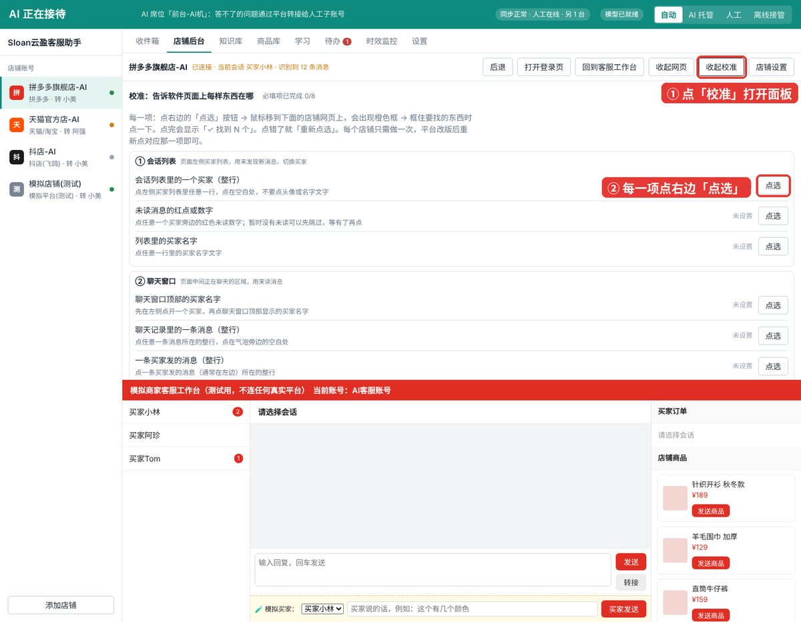

面板分 5 组，每一行是一样东西。右边的「点选」按钮就是让你去网页上指出它。

### 第 2 步：逐项点选

操作都一样：**点某一行右边的「点选」→ 鼠标移到下面的网页上，会出现橙色框 → 橙色框框住要找的东西时点一下。**

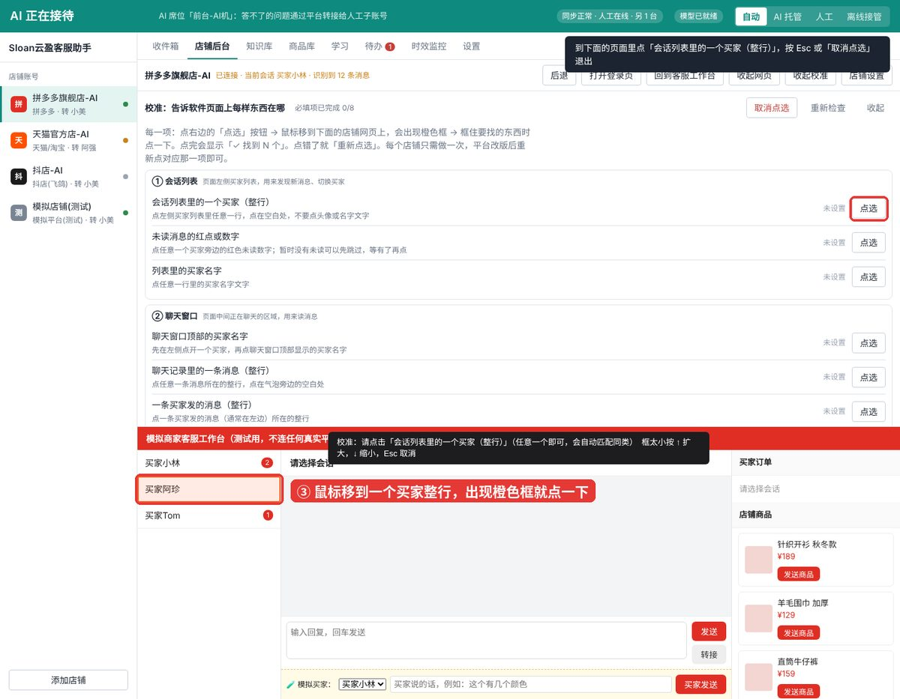

- 点完这一行会变绿，显示「✓ 找到 N 个」和「识别到：xxx」。**看「识别到」的文字对不对**，就知道点没点准。
- 橙色框太小（只框住了文字，没框住整行）：不要点，按键盘 **↑** 键，框会往外扩一层；扩过头按 **↓**。
- 点错了：再点那一行的「重新点选」。想中途退出：按 **Esc** 或面板右上角「取消点选」。

各项怎么点：

| 组 | 项目 | 怎么点 | 点对了的样子 |
| --- | --- | --- | --- |
| ① 会话列表 | 会话列表里的一个买家（整行） | 左侧买家列表任意一行的空白处，不要点头像或名字 | 找到的数量 = 列表里的买家数 |
| | 未读消息的红点或数字 | 买家旁边的红色未读数字；暂时没有未读可以先跳过 | 识别到：数字 |
| | 列表里的买家名字 | 任意一行里的买家名字文字 | 识别到：买家名 |
| ② 聊天窗口 | 聊天窗口顶部的买家名字 | 聊天区最上面显示的买家名 | 找到 1 个 |
| | 聊天记录里的一条消息（整行） | 任意一条消息所在整行，点气泡旁边的空白处 | 找到的数量 ≈ 屏幕上的消息条数 |
| | 一条买家发的消息（整行） | 左边买家的一条消息所在整行 | 识别到：买家说的话 |
| | 一条我方发的消息（整行） | 右边我方的一条消息所在整行 | 识别到：我方说的话 |
| | 消息的文字气泡 | 气泡本身（只框文字那一块） | 识别到：消息文字 |
| | 系统提示（可选） | 灰色的「会话已转接」之类；没有就跳过 | — |
| ③ 回复 | 回复输入框 | 底部打字的输入框 | 找到 1 个 |
| | 发送按钮（可选） | 「发送」按钮；回车就能发的平台可以跳过 | 找到 1 个 |
| ④ 订单与商品（可选） | 一张订单卡片（整张） | 右侧订单栏里一张订单卡片的空白处 | 识别到：订单号、商品…… |
| | 订单卡片上的「发送」按钮 | 那张卡片上平台自带的「发送订单」 | 识别到：发送订单 |
| | 一张商品卡片（整张） | 右侧商品栏里一个商品卡片的空白处 | 识别到：商品名 价格 |
| | 商品卡片上的「发送」按钮 | 商品卡片上平台自带的「发送」 | 识别到：发送 |

**“整行”和“气泡”的区别**最容易搞错：「一条消息（整行）」要框住整条横向区域；「文字气泡」只框文字那一块。

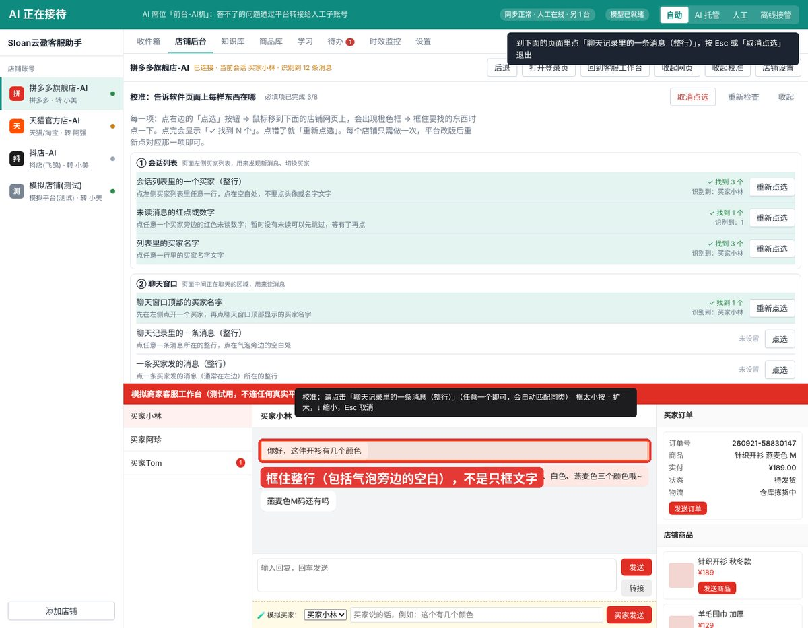

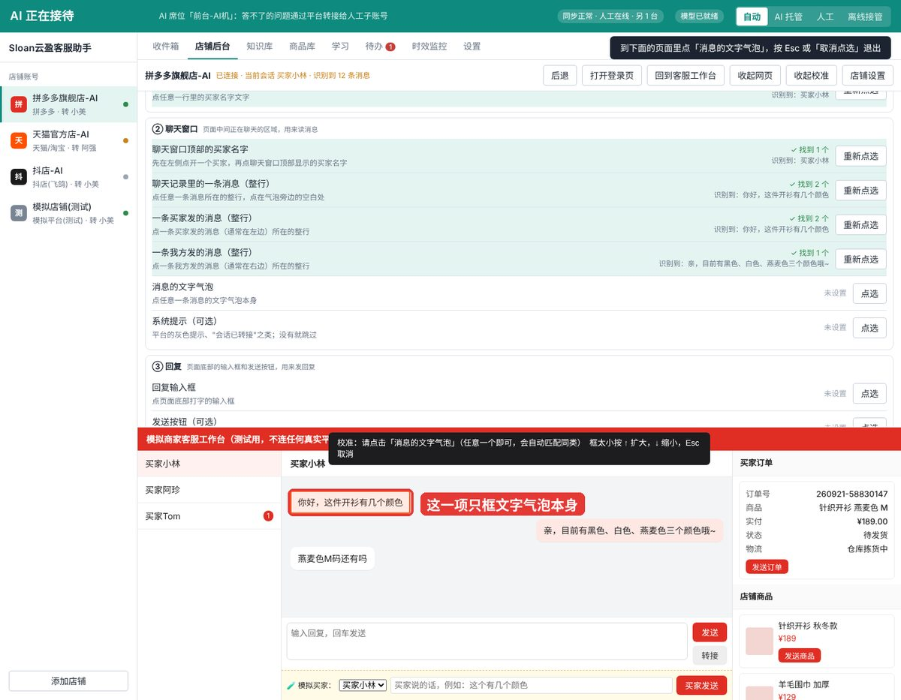

④ 订单与商品：先在左侧点开一个**有订单的买家**，右侧订单栏里出现订单卡片后再点。点在卡片空白处，框住整张卡片；框小了按 ↑。

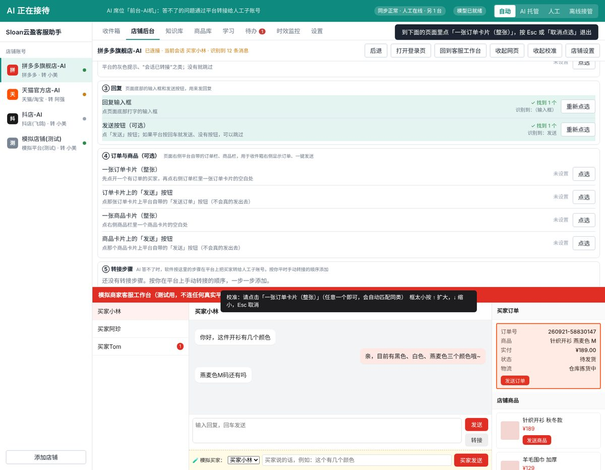

### 第 3 步：检查结果

所有必填项完成后，面板顶部显示「必填项已完成 8/8」。逐行看一眼：

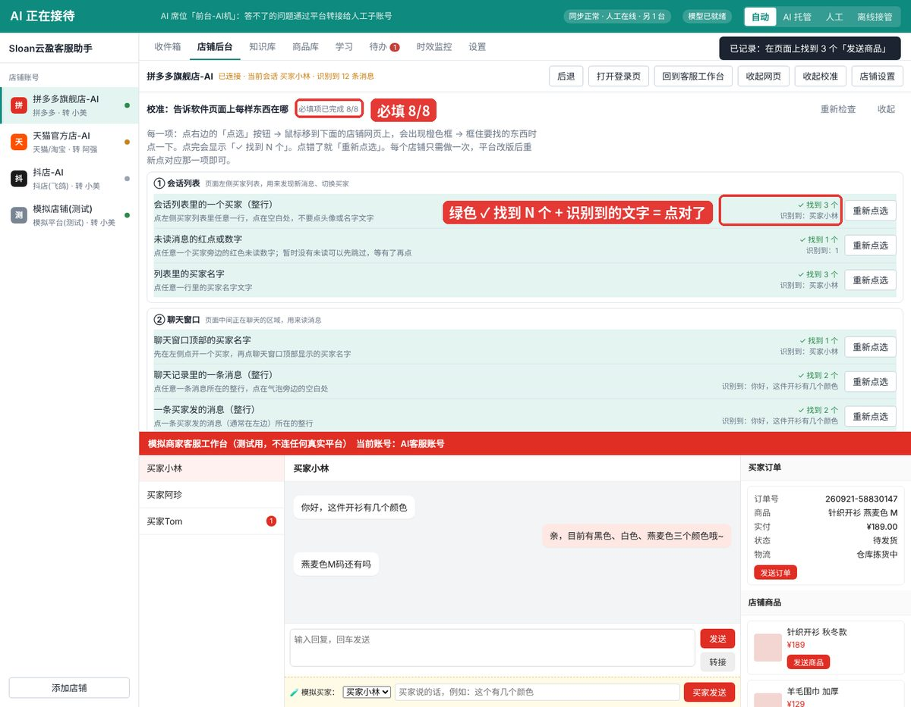

- 绿色 **✓ 找到 N 个** + 识别到的文字正确 = 点对了。
- 橙色 **当前页面找到 0 个**：可能是那样东西暂时不在屏幕上（比如没有未读红点），或者点错了。先点「重新检查」，还是 0 就重新点选。
- 橙色 **找到 N 个，应该只有 1 个**：输入框、聊天标题这类只有一个的东西匹配到了多个，请重新点选，点得更准一点。

### 第 4 步：录转接步骤

AI 答不了的问题，软件会替你在平台上把买家转给人工子账号。你需要按平时手动转接的顺序，把每一步告诉软件。面板最下面「⑤ 转接步骤」：

1. 每一步先在下拉框里选「这一步做什么」，再点「点选」，到网页上点对应位置。
2. 不够就点「添加一步」，多了点「删除」。改完自动保存。

以模拟店铺为例，4 步是：

| 步骤 | 下拉框选 | 网页上点 |
| --- | --- | --- |
| 1 | 点击一个按钮 | 聊天窗口里的「转接」按钮 |
| 2 | 在输入框里输入人工客服名 | 转接弹窗里的搜索框 |
| 3 | 在列表里点名字是人工客服的那一项 | 客服列表里任意一个客服（软件会自动找名字对的那个） |
| 4 | 点击一个按钮 | 「确认转接」按钮 |

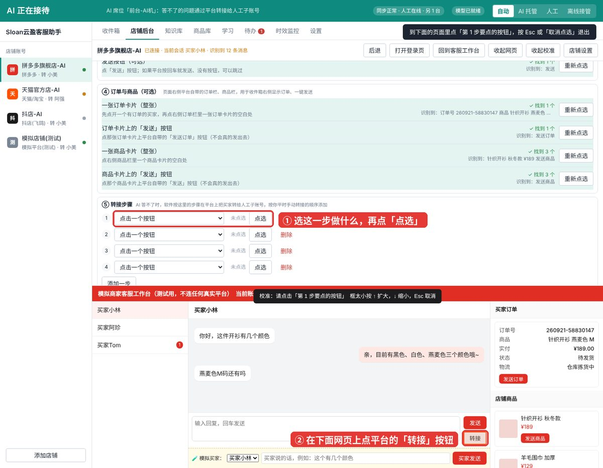

点第 1 步时，平台的转接弹窗会照常弹出来，接着点第 2、3、4 步的位置即可。

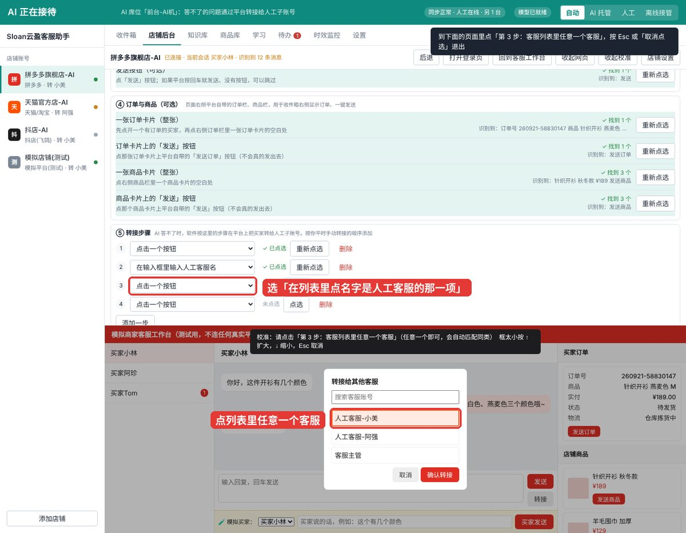

4 步都显示「✓ 已点选」就完成了。

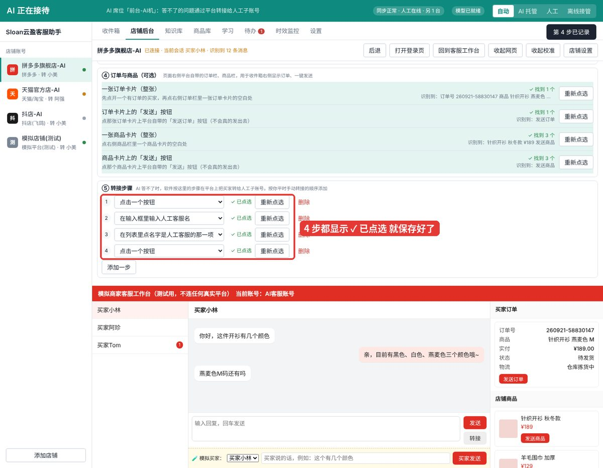

真实平台的步骤以你平时手动转接的操作为准，有的平台只要 2 步（点转接 → 点客服名），有的要 4 步。人工子账号的名字在「店铺设置」里改，步骤里会自动替换。

### 校准常见问题

| 现象 | 处理 |
| --- | --- |
| 收件箱收不到这个店的消息 | 看「会话列表」「一条消息（整行）」「文字气泡」是否都是绿色、识别到的文字对不对 |
| 买家和我方的消息分不清 | 重新点选「一条买家发的消息」「一条我方发的消息」，都点整行 |
| AI 回复没发出去 | 重新点选「回复输入框」「发送按钮」 |
| 转接失败、进了待办 | 检查人工子账号名字和平台列表里一致；重新录转接步骤 |
| 平台改版后突然不灵 | 打开校准，点「重新检查」，哪项变橙色就重新点选哪项 |

## 一条消息怎么处理

1. 买家 1.2 秒内连发的几条合并成一条。
2. 命中订单 / 物流 / 售后 / 投诉关键词 → 直接按“答不了”处理。
3. 知识库命中（关键词 / 包含问法 / 相似度 ≥ 0.72）→ 直接用知识库答案回复（约 2 秒，不需要模型）。
4. 否则交给模型作答，置信度 ≥ 0.6 → 发送模型回复（约 5 秒）。
5. 答不了：AI 托管 → 发转接提示并转人工子账号；离线接管 → 发分类保底话术并记待办。
6. 任何一步超过 18 秒还没答复，自动发保底话术。人工模式下流程照走，但只生成草稿、不发送。

## 收件箱

- **看决策过程**：每条买家消息下方显示 AI 的处理步骤和总耗时，超过 20 秒显示为红色。
- **直接回复**：在底部输入框打字发送，消息通过店铺网页发出，该会话自动转为人工接管。
- **接管 / 交回**：「我来接管」让 AI 不再回这个买家；「交回 AI」恢复。在平台网页里直接打字回复，效果相同。
- **改写回答**：点「改写成更好的回答」，可以顺便发给买家。改写内容进入「学习」等你确认。

## 收件箱右侧：订单与商品

收件箱选中一个买家后，右侧有三个标签：

- **订单**：从店铺网页读出这个买家的订单（订单号、商品、实付、状态、物流）。点「发送订单」= 在平台上点它自带的「发送订单」按钮，买家收到的是平台的订单卡片；「复制」把订单信息复制下来。
- **店铺商品**：店铺网页商品栏里的商品，点「发送」发出平台商品卡片。
- **商品库**：你自己导入的商品，可搜索，点「发送」发出「商品名 价格 链接」。

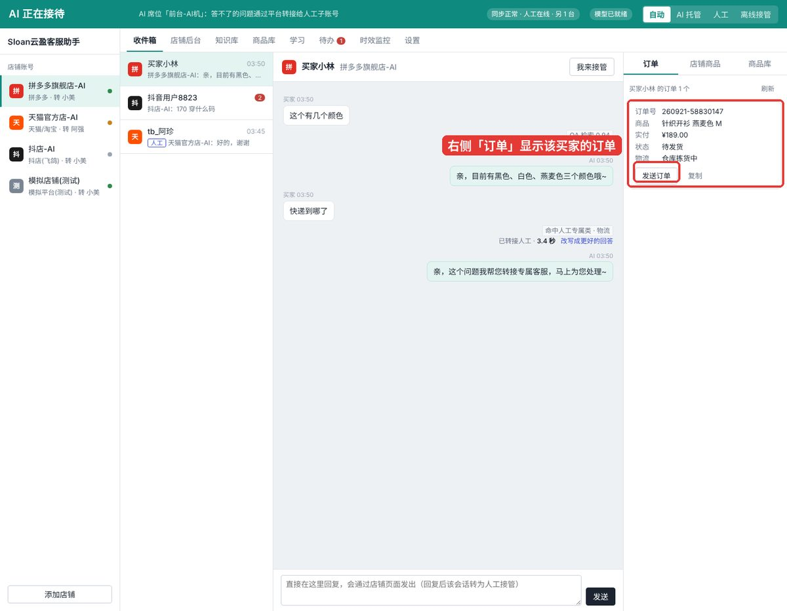

前两项需要在校准里点选「④ 订单与商品」，没校准时右侧会提示去校准。一键发送出去的卡片不会被当成人工插话，AI 照常托管。

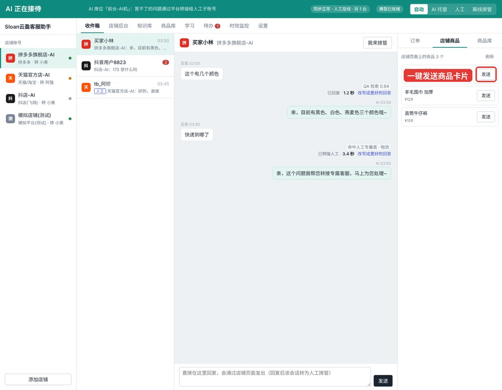

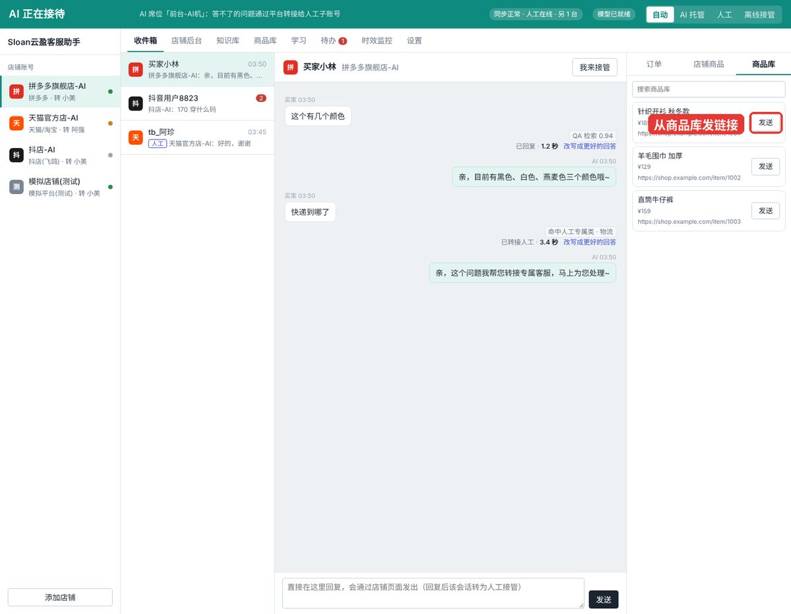

**AI 也会用到订单**：AI 托管和离线接管时，交给模型作答前会先读这个买家的订单作参考（设置里「参考订单信息」可关）。订单、物流、售后类问题默认仍然直接转人工。

## 商品库

「商品库」页面管理常用商品：

- **导入 Excel**：第一行表头 商品名、链接、价格、介绍、关键词、品牌，模板见 `samples/商品库模板.xlsx`。关键词写法和知识库一样：多组用 | 分隔，一组里用 + 表示都要出现。同名商品再导入会更新。
- **新增 / 编辑 / 删除**：在列表里直接操作。

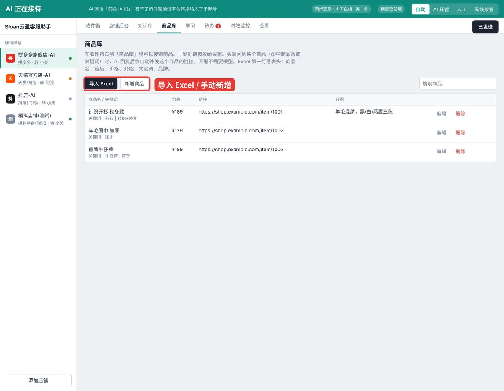

**自动带链接**：买家的话里出现商品名或关键词（例如「开衫有 M 码吗」），AI 回复之后会自动补发这个商品的链接。每个买家每个商品只发一次。设置里「自动带商品链接」可关。匹配在本机完成，不需要模型。

双机同步开启时，商品库和知识库一样在两台电脑之间同步。

## 知识库与学习

**导入 Excel**：「知识库 → 导入 Excel」。第一行写表头：

| 表头 | 必填 | 说明 |
| --- | --- | --- |
| 问题 | 是 | 标准问法 |
| 答案 | 是 | AI 直接发出的话 |
| 相似问法 | 否 | 多个用 \| 分隔 |
| 关键词 | 否 | 买家的话里出现就命中，多组用 \| 分隔；一组里用 + 表示都要出现，如 多久+发 \| 发货 |
| 分类 | 否 | 售前 / 物流 / 售后等 |
| 品牌 | 否 | 留空 = 所有店铺通用 |

**怎么匹配（不需要模型）**：买家的话命中某条的关键词、或一长句里包含标准问法、或和问法/相似问法足够相似，就直接用这条答案回复。三种方式都在本机完成，不需要配置模型。

**试答**：在「试一句买家的话」里输入，看会命中哪条、匹配度多少、命中原因是什么。

**学习**：人工模式下，AI 把人工的回答整理成候选问答，手机号和地址会被替换掉。样本满 20 条且吻合率达到 90% 时提示「可以交给 AI 托管」。候选问答**必须点「加入知识库」才生效**；标黄的含单号、补偿等一次性内容，确认前请改成通用说法。

## 待办与时效监控

**待办**：离线接管期间 AI 处理不了的会话、转接失败的会话都记在这里，处理完点「标记已处理」。

**时效监控**：重点看「20 秒内完成」（目标 98% 以上）、「超过 30 秒」（应该是 0）、「90% 在几秒内」。

## 设置

改完记得点底部「保存设置」。

**模型**：任意模型都能驱动，可以配多个，从上到下按顺序使用，前一个失败自动换下一个。**一个都不启用也能用**：知识库能答的照常自动回复，其余转人工或发保底话术。

1. 点「添加模型」或在已有卡片上选平台。
2. 点「获取 Key」去对应平台申请 API Key，填进去。本地模型（Ollama）不用 Key。
3. 点「获取型号」查当前能用的型号，在「型号名」里选一个。
4. 勾选「启用」，点「测试」，看到「连接成功」和试答内容即可。
5. 用 ↑ ↓ 调整优先顺序。

| 平台 | 默认型号 | 要 Key |
| --- | --- | --- |
| 通义千问（阿里云百炼） | qwen-plus | 是 |
| DeepSeek | deepseek-flash | 是 |
| 智谱 GLM | glm-4.7-flash（免费档） | 是 |
| Kimi（月之暗面） | kimi-k2.6 | 是 |
| 豆包（火山方舟） | doubao-seed-1-8-251228 | 是 |
| OpenAI | gpt-4.1-mini | 是 |
| Claude | claude-haiku-5-5 | 是 |
| 本地模型（Ollama） | qwen3:8b | 否 |
| 自定义 | 任何 OpenAI 兼容接口，自填地址和型号 | 视接口 |

「店铺通用信息」填品牌、发货地、发货时效、售后政策，模型作答时会参考。

**本机席位**：AI 电脑选「AI 席位」，人工电脑选「人工席位」。

**双机同步**：在其中一台电脑运行同步服务并设密码；两台都填 `http://那台电脑的局域网IP:8787` 和同一个密码。

**回复规则**：

| 项目 | 默认 | 作用 |
| --- | --- | --- |
| QA 直接回复阈值 | 0.72 | 相似度达到就直接用知识库答案 |
| 模型最低置信度 | 0.6 | 低于就视为答不了 |
| 保底时限 | 18000 毫秒 | 到点还没答复就发保底话术，最多 28 秒 |
| 先发安抚语 | 0（关） | 超过该时长先回一句「正在为您查询」 |
| 平台自动回复关键词 | 空 | 平台欢迎语里的词，含这些词的卖家消息不算人工插话 |
| 自动带商品链接 | 开 | 买家问到商品库里的商品，回复后补发链接 |
| 参考订单信息 | 开 | 模型作答前读取该买家订单 |
| 必须人工处理的问题 | 投诉、售后、订单、物流 | 每类可改关键词和保底话术 |

## 常见问题

**打不开 / 提示无法验证开发者**：见上方「安装与启动」。

**界面点不动**：按 Esc 关掉弹窗；在店铺后台可点「收起网页」。仍不行就退出重开，数据不会丢。

**圆点一直是橙色**：登录已过期，或还没校准。

**右侧订单栏是空的**：在校准里点选「④ 订单与商品」；确认店铺网页右侧本来就显示订单。

**AI 不回复某个买家**：该会话可能已被人工接管（收件箱里带「人工」标签），点「交回 AI」。或者当前是「人工」模式。

**模型测试失败**：401/403 = Key 不对；404 = 接口地址或型号名不对，点「获取型号」；429 = 额度用完。

**转接失败**：检查人工子账号名字是否和平台列表一致、人工子账号是否在线；失败的会话会进待办。

注意：自动化操作商家后台有平台风控风险，先用一家店、小流量验证。
